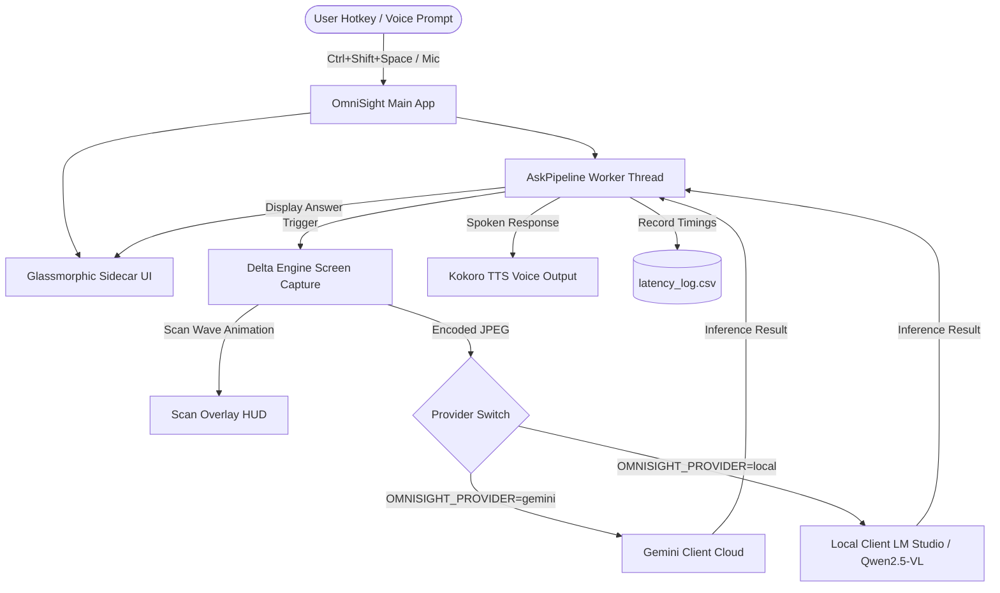

# OmniSight AI

<p align="center">
  <strong>Real-Time Multimodal Desktop AI Copilot with Screen Vision & Voice Talkback</strong>
</p>

<p align="center">
  
  
  
  
  
</p>

---

## 🌟 Overview

**OmniSight AI** is a lightweight, futuristic Windows desktop copilot that acts as your second pair of eyes and ears. With a single keystroke or voice prompt, OmniSight captures your active workspace, processes visual context through cutting-edge vision models (**Google Gemini** or **Local Qwen2.5-VL** via LM Studio), and delivers concise answers in a glassmorphic floating sidecar — complete with natural spoken talkback.

Whether you are debugging code, reading complex schematics, analyzing charts, or navigating software workflows, OmniSight delivers immediate context-aware guidance without disrupting your flow.

---

## ✨ Key Features

### 👁️ Multimodal Screen Intelligence
- **Global Hotkey Trigger (`Ctrl+Shift+Space`)**: Instantly captures the primary display without interrupting active applications.
- **Delta Engine Optimization**: High-speed, multi-threaded screenshot acquisition (`mss`) and smart JPEG compression (`opencv-python`) to minimize latency and token payloads.
- **Visual Scanning Wave**: Cyberpunk-style animated laser scan overlay during screen analysis.
- **Live Monitor Overlay (`Ctrl+Shift+L`)**: Interactive HUD overlay for continuous visual feedback.

### ⚡ Hybrid AI Providers (Cloud or 100% Offline)
- **Google Gemini API**: Blazing fast cloud multimodal inference via Gemini Flash with automatic backoff, bounded retries, and comprehensive error handling.
- **Local Private LLM (LM Studio / OpenAI-Compatible)**: Run entirely local and private with vision models like `qwen/qwen2.5-vl-7b` on `http://localhost:1234/v1`. Zero cloud dependencies, zero data leaks.

### 🎙️ Bidirectional Voice Interaction
- **Speech-to-Text (Voice Input)**: Low-latency local microphone capture powered by `faster-whisper`.
- **Natural Voice Talkback (TTS)**: Realistic speech synthesis powered by `kokoro` (featuring British voice *bm_george*), post-processed with Butterworth filtering for broadcast-grade audio warmth.

### 💎 Cyberpunk Glassmorphic Sidecar
- Always-on-top translucent PyQt6 floating panel with smooth animations, glow status pills, and responsive chat/vision modes.
- Thread-safe request queue: Prevents request pile-ups while keeping the UI responsive at 60 FPS.

### 📊 Observability & Latency Logging
- Automatic stage-by-stage timing: Capture, encoding, inference roundtrip, and total elapsed latency are displayed in real time and logged to `latency_log.csv`.

---

## 🏗️ Architecture



---

## ⌨️ Controls & Hotkeys

| Action | Hotkey / Trigger | Description |
|---|---|---|
| **Ask Screen** | `Ctrl + Shift + Space` | Captures the active screen and queries the configured AI provider. |
| **Toggle Live Overlay** | `Ctrl + Shift + L` | Displays / hides the interactive visual HUD overlay. |
| **Voice Chat** | Sidecar Mic Button | Records speech, transcribes locally via Whisper, and plays audio reply. |
| **Move Panel** | Click & Drag | Freely position the floating sidecar anywhere on your screens. |
| **Quit App** | Window ✕ Button | Gracefully shuts down workers and unhooks all system hotkeys. |

---

## 🚀 Getting Started

### Prerequisites

- **OS**: Windows 10 or 11 (64-bit)
- **Python**: 3.10, 3.11, or 3.12 installed and added to `PATH`
- **Microphone & Speakers**: Required for voice input/output features

### 1. Clone the Repository

```bash
git clone https://github.com/CRAZY9YT/OmniSight-AI.git
cd OmniSight-AI
```

### 2. Create and Activate a Virtual Environment

```powershell
python -m venv .venv
.\.venv\Scripts\Activate.ps1
```

### 3. Install Dependencies

```bash
pip install --upgrade pip
pip install -r requirements.txt
```

---

## ⚙️ Configuration

OmniSight can be configured via environment variables in your terminal or a `.env` file:

### Option A: Using Google Gemini (Cloud)

Get a free API key from [Google AI Studio](https://aistudio.google.com/apikey).

```powershell
# Set provider to Gemini
$env:OMNISIGHT_PROVIDER="gemini"
$env:GEMINI_API_KEY="your_actual_gemini_api_key_here"

# (Optional) specify custom model:
$env:OMNISIGHT_MODEL="gemini-2.5-flash"
```

### Option B: Using LM Studio / Local Vision Model (100% Offline & Private)

1. Download and run [LM Studio](https://lmstudio.ai/).
2. Load a vision-capable model (recommended: `qwen2.5-vl-7b-instruct` or similar).
3. Start the local server on port `1234`.

```powershell
# Set provider to Local (default)
$env:OMNISIGHT_PROVIDER="local"
$env:OMNISIGHT_LOCAL_URL="http://localhost:1234/v1"
$env:OMNISIGHT_LOCAL_MODEL="qwen/qwen2.5-vl-7b"
```

---

## 💻 Running the Application

Launch OmniSight AI with:

```bash
python main.py
```

Upon launch:
- The floating **Sidecar UI** appears on your desktop.
- Global hotkeys `Ctrl+Shift+Space` and `Ctrl+Shift+L` are registered.
- Press `Ctrl+Shift+Space` at any time over any window or IDE to analyze your screen!

---

## 📂 Project Structure

```text
OmniSight-AI/
├── ask_pipeline.py       # Threaded request manager, voice coordination, timing log
├── delta_engine.py       # Screen capture (mss), JPEG compression, diff detection
├── gemini_client.py      # Google Gemini API client with retry and error recovery
├── live_monitor.py       # Continuous context-aware monitoring and visual memory
├── live_viewer.py        # Interactive screen HUD overlay widget
├── local_client.py       # OpenAI-compatible local client (LM Studio / Qwen2.5-VL)
├── main.py               # Main application entry point and hotkey bindings
├── requirements.txt      # Python package dependencies
├── scan_overlay.py       # Full-screen cyberpunk scan line animation
├── sidecar_ui.py         # Floating glassmorphic PyQt6 desktop UI
├── voice_input.py        # Local speech recognition using Faster-Whisper
├── voice_output.py       # Local voice synthesis and playback using Kokoro TTS
└── test_*.py             # Automated unit tests and sound/pipeline validation
```

---

## 🔒 Privacy & Security

- **Local Mode**: When using `OMNISIGHT_PROVIDER=local`, no image, audio, or text leaves your machine.
- **Cloud Mode**: When using `gemini`, a single compressed screenshot is transmitted per hotkey press over encrypted HTTPS to Google's API. No background recording occurs.
- **Timings**: `latency_log.csv` records only execution timestamps and durations, never screen imagery or queries.

---

## 🤝 Contributing

Contributions, issues, and feature requests are welcome!
Feel free to open an issue or submit a Pull Request.

1. Fork the Project
2. Create your Feature Branch (`git checkout -b feature/AmazingFeature`)
3. Commit your Changes (`git commit -m 'Add some AmazingFeature'`)
4. Push to the Branch (`git push origin feature/AmazingFeature`)
5. Open a Pull Request

---

## 📜 License

Distributed under the **MIT License**. See `LICENSE` for more information.

<p align="center">
  Crafted with care by <a href="https://github.com/CRAZY9YT">CRAZY9YT</a>
</p>
